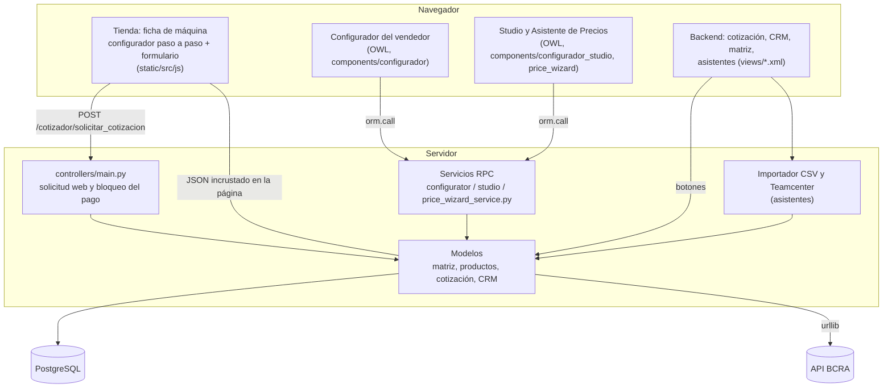
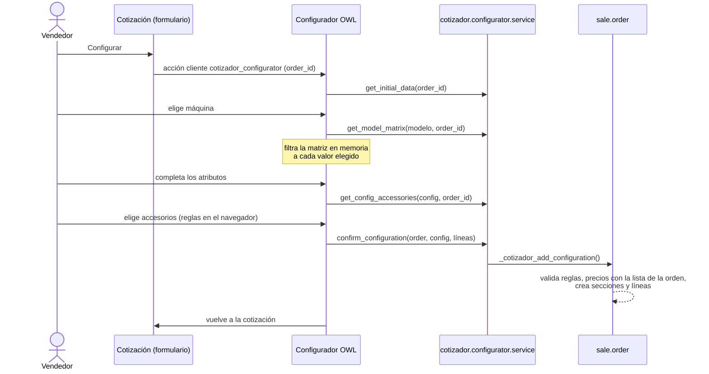
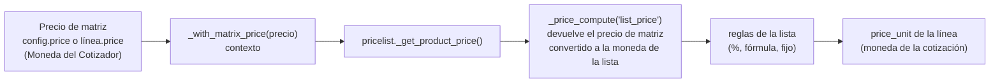
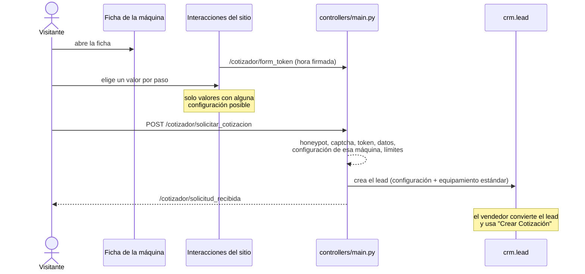

# Arquitectura

## Las capas

**Regla de oro: la regla de negocio vive en los modelos.** El JavaScript guía al usuario (bloquea
accesorios, deshabilita botones) pero el servidor vuelve a validar todo y calcula todos los precios. Los
tres caminos para cotizar una máquina —configurador, CRM y tienda— terminan en el mismo método,
`sale.order._cotizador_add_configuration()`.

## Qué hay en cada archivo

### Modelos (`models/`)

| Archivo | Contenido |
|---|---|
| `sembradora_config.py` | **Matriz**: `sembradora.config.rel` (configuración: combinación, precio, accesorios). Restricciones de combinación única y de reglas; oferta de accesorios (`_get_accessory_offer`), validación de una selección y creación de la variante. `validate_rule_set()` es la validación de reglas que comparten la restricción y el importador. |
| `sembradora_config_acc_line.py` | Línea de accesorio de una configuración: precio, reglas, estándar, habilitante. Exige que el accesorio sea del mismo modelo. |
| `sembradora_accessory_rule.py` | Reglas: exclusión, inclusión y opción única. |
| `product_template_inherit.py` | Máquinas y accesorios (`is_maquina`, `is_accesorio`, *Moneda del Cotizador*, *Modelo de Máquina*); **precios de matriz** (`_price_compute`); combinaciones posibles e índice en caché de configuraciones; JSON del configurador de la tienda; descripción paramétrica. |
| `product_category_inherit.py` | *Atributo de Cantidad* de una categoría (accesorios por línea, por metro…). |
| `product_attribute_inherit.py` | Opciones de visualización del atributo; `cotizador_qty` del valor. |
| `sale_order_inherit.py` | **Cotización**: alta de una configuración, cascada de totales, sincronización con el CRM, modos de aceptación en el portal, BCRA, impresión. Líneas: `cotizador_section` y marcas de descuento, usado y plan de pago. |
| `crm_lead_inherit.py` | Oportunidad: configuración pedida en la web, IP, *Crear Cotización*, ingreso esperado en moneda de la compañía. |
| `configurator_service.py` | RPC del configurador del vendedor. |
| `studio_service.py` | RPC del Studio (solo administrador). |
| `price_wizard_service.py` | RPC del Asistente de Precios (solo administrador). |
| `sembradora_import_wizard.py` | Importador CSV (ver [importador](importador.md)). |
| `engineering_code_wizard.py` | Códigos Teamcenter: plantilla, simulación y aplicación por SQL. |
| `plan_pago.py` | Plantillas de planes de pago y su asistente de selección. |
| `descuento_wizard.py`, `equipo_usado_wizard.py` | Asistentes de descuento comercial y toma de usado. |
| `bcra_service.py`, `bcra_wizard.py` | Cliente de la API del BCRA (funciones puras) y el informe. |
| `res_company.py`, `res_config_settings.py`, `res_users_inherit.py` | Ajustes (compañía y parámetros) y planes favoritos del vendedor. |

### Web, vistas y datos

| Archivo / carpeta | Contenido |
|---|---|
| `controllers/main.py` | Token del formulario, solicitud de cotización (lead u oportunidad + cotización) y bloqueo de checkout, express checkout y transacción de pago en modo "Solo cotización". |
| `static/src/js/cotizador_sequential_configurator.js` | Configurador paso a paso de la ficha de la máquina en la tienda. |
| `static/src/js/cotizador_quote_form.js` | Completa el token firmado del formulario *Solicitar Cotización*. |
| `static/src/components/configurador/` | Configurador del vendedor (OWL + plantilla + estilos). |
| `static/src/components/configurador_studio/` | Studio: árbol de la matriz. |
| `static/src/components/price_wizard/` | Asistente de Precios. |
| `static/tests/tours/` | Tours de navegador de los tests. |
| `views/website_sale_templates.xml` | Ficha de producto de la tienda: configurador, modal *Solicitar Cotización*, errores, página de confirmación. |
| `views/portal_templates.xml` | Cotización en el portal con la cascada de totales y los modos de aceptación. |
| `views/views.xml` | Formulario de la cotización: botones del cotizador y totales. |
| `views/*_view(s).xml` | Resto de las pantallas, menús y acciones cliente. |
| `report/report_cotizacion_planes.xml` | Cotización impresa con hoja de planes de pago. |
| `data/product_category_data.xml` | Categorías *Máquina* y *Accesorio* (`noupdate`). |
| `data/product_plan_pago_data.xml` | Un producto de servicio por tipo de plan de pago. |
| `security/` | Grupo *Administrador del Configurador* y permisos por modelo. |
| `tests/` | Tests (Python, HTTP y tours). `common.py` tiene el CSV de ejemplo. |
| `tools/documentacion.py` | Verificador de documentación y generador de [la referencia](referencia.md). |
| `scripts/` | Herramientas de escritorio para dividir CSV grandes (no las carga Odoo). |
| `docs/Doxyfile` | Configuración de Doxygen para la documentación del código. |

La lista completa de modelos, campos, permisos y quién llama a cada método está en la
[referencia generada](referencia.md). La documentación de cada función está en el código (ver
[Recetas › Documentar código](recetas.md#documentar-código)).

## Cómo viaja un pedido

### El vendedor configura una máquina

### Cómo se calcula un precio

- Si la moneda del producto y la de la lista son iguales, el importe pasa sin conversión.
- En la tienda, una máquina sin combinación elegida muestra su configuración más barata ("desde").
- La cantidad (accesorios por línea) se calcula antes y viaja aparte: las reglas por cantidad mínima de
  la lista la ven.

### Un visitante pide cotización en la tienda

Un cliente con sesión iniciada recibe además la cotización (estado *Enviada*) y se lo lleva al portal.

### Importación de la matriz

Ver el detalle en el [importador](importador.md). En corto: el análisis valida todo y no escribe; la
importación revalida lo analizado y escribe en orden atributos → categorías de cantidad → modelos →
accesorios → reglas → configuraciones, todo en una transacción.

## Decisiones de diseño que conviene conocer

- **Nunca buscar por nombre.** Los registros del módulo se identifican por xmlid (`cotizador.cat_maquina`,
  `cotizador.product_plan_<tipo>`, `cotizador_import.*`) o por campos propios (`cotizador_section`,
  `is_descuento`). Renombrar algo en Odoo no rompe nada.
- **La matriz es la fuente de verdad.** Una combinación que no está en la matriz no se puede cotizar ni
  elegir en la tienda (`_is_combination_possible`).
- **Una variante por configuración, creada con la matriz.** Atributos en modo *Siempre*; Odoo crea solo
  las variantes de las combinaciones de la matriz (`_filter_combinations_impossible_by_config`) y se
  resincronizan al cambiar configuraciones. Cotizar nunca crea variantes. El código de Teamcenter va a la
  referencia interna de la variante.
- **Precios solo en la matriz.** El precio de venta del producto no se usa ni se escribe para máquinas y
  accesorios; el precio de un accesorio depende de la configuración. Cada línea de la cotización guarda el
  precio de matriz con que se cotizó (`cotizador_matrix_price`): si Odoo recalcula el precio (cambio de
  cantidad, *Actualizar precios*) parte de ese valor.
- **Descuentos y plan sobre el neto, siempre al día.** Se aplican antes del IVA, una línea por grupo de
  impuestos, y los de porcentaje se recalculan al cambiar las líneas (`_cotizador_update_adjustments`).
- **Moneda por producto.** Cada máquina y accesorio tiene su *Moneda del Cotizador*; la compañía puede
  estar en otra moneda.
- **Accesorios por modelo.** Un accesorio es de una sola máquina; el mismo nombre en dos máquinas son dos
  productos. Así el precio y la configuración de un accesorio de una máquina no afectan a otra.
- **Índice en caché.** Las combinaciones de cada máquina se leen de `_cotizador_config_index` (memoria);
  crear, modificar o borrar configuraciones lo invalida. Un cambio hecho por SQL directo (Teamcenter solo
  toca códigos) no lo necesita.
- **Secciones identificadas por campo.** `sale.order.line.cotizador_section` marca Máquina, Equipamiento,
  Accesorios, Descuentos y Usados; el texto de la sección se puede cambiar.
- **Ingreso esperado convertido.** La oportunidad toma el saldo de su última cotización (o pedido
  confirmado) convertido a la moneda de la compañía.

## Ver también

- [Conceptos de Odoo](odoo.md)
- [Flujos](flujos.md) · [Seguridad](seguridad.md)
- [Referencia generada](referencia.md)
