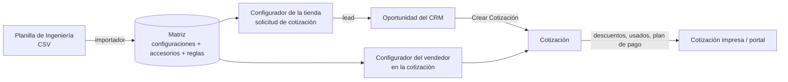

# Conceptos

## La idea central: la matriz de ingeniería

Una sembradora no se vende "de catálogo": se arma eligiendo atributos (cantidad de líneas, distancia
entre líneas, tecnología, tolva…). No todas las combinaciones existen. Ingeniería define cuáles son
válidas, cuánto cuesta cada una y qué accesorios admite. Eso es la **matriz de ingeniería**, y todo el
módulo gira alrededor de ella:

## Quién usa el módulo

| Rol | Dónde trabaja | Qué hace |
|---|---|---|
| Visitante de la tienda | Sitio web, sin sesión | Configura una máquina paso a paso y pide cotización. Se crea **solo un lead** del CRM. |
| Cliente con usuario portal | Sitio web y portal `/my` | Igual, pero recibe la cotización a su nombre en el portal; puede aceptarla si el vendedor lo habilita. |
| Vendedor (usuario interno) | Backend: Ventas y CRM | Lee la matriz. Cotiza con el configurador, agrega descuentos, usados y plan de pago, imprime y consulta el BCRA. |
| Administrador del Configurador | Backend: *Ventas › Configuración › Configurador Sembradoras* | Todo lo del vendedor, más la matriz: importador, Teamcenter, reglas y planes de pago. |

## Glosario

| Término | Significado | En Odoo |
|---|---|---|
| **Máquina** (modelo) | Producto configurable, p. ej. "Pionera". | `product.template` en la categoría *Máquina* (`is_maquina`). |
| **Atributo / valor** | Característica elegible y sus opciones ("Cantidad de Líneas" → "16 Líneas"). | `product.attribute` / `product.attribute.value`, en modo de variantes *Siempre*. |
| **Configuración** | Una combinación **completa y válida** de valores de una máquina, con su precio. | `sembradora.config.rel`. Única por máquina y combinación. |
| **Variante** | El producto concreto de una configuración: hay **una por configuración**, creada con la matriz (no al cotizar). Lleva el código de Teamcenter como referencia interna. | `product.product`. |
| **Accesorio** | Producto opcional que se agrega a una máquina. **Pertenece a un solo modelo**: "Monitor" de la Pionera y "Monitor" de la Drilla son dos productos. | `product.product` en la categoría *Accesorio* (`is_accesorio`), con *Modelo de Máquina* (`cotizador_modelo_id`). |
| **Línea de accesorio** | Un accesorio compatible con una configuración, con su precio **en esa configuración**. | `sembradora.config.accessory.line`. |
| **Equipamiento estándar** | Accesorios que vienen incluidos: arrancan elegidos y van en la sección *Equipamiento*. | `is_standard` de la línea; `ESTANDAR` en el CSV. |
| **Regla de exclusión** (`:e`) | Grupo de accesorios del que se elige como máximo uno (p. ej. dos cuchillas distintas). | `sembradora.accessory.rule`, tipo `exclusion`. |
| **Regla de inclusión** (`:i` / `:it`) | Los accesorios del grupo solo se pueden elegir si está elegido su **habilitante** (`:it`, p. ej. el sensor necesita el monitor). | Tipo `inclusion`; el habilitante tiene `is_trigger`. |
| **Opción única** (`:u`) | Grupo del que siempre hay **exactamente uno**: arranca el estándar y elegir otro lo reemplaza. Una opción puede estar además en una exclusión. Se muestra como botones de radio con la diferencia de precio. | Tipo `choice`. |
| **Cantidad dinámica** (`Calc_param`) | Accesorio que se cotiza por unidad de un atributo: un sensor **por línea** en una máquina de 16 líneas → 16 sensores. | Categoría con *Atributo de Cantidad*; el número sale de `cotizador_qty` del valor. |
| **Moneda del Cotizador** | Moneda en la que están los precios de la matriz de un producto (máquina o accesorio). Puede no ser la de la compañía (p. ej. compañía en ARS, matriz en USD). | `cotizador_currency_id` del producto. |
| **Lista de Precios de Cotizaciones** | Lista de precios (y por lo tanto moneda) de las cotizaciones de máquinas. | Ajuste de la compañía `cotizador_pricelist_id`. |
| **Descripción paramétrica** | Texto técnico que se arma según los valores elegidos (la regla más específica gana). | `product.template.description.line`. |
| **Código de ingeniería (Teamcenter)** | Código de la variante en el sistema de ingeniería. | Referencia interna (`default_code`) de la variante. |
| **Cascada de totales** | SUB TOTAL → descuentos → plan de pago → SUB TOTAL NETO → IVA → TOTAL → usados → SALDO A CANCELAR. | Campos `amount_*` de `sale.order`. |
| **Descuento comercial** | Bonificación sobre el **neto** (sin IVA), en porcentaje (en cascada) o monto fijo; el IVA se calcula después. | Línea `is_descuento`, sección *Descuentos*. |
| **Toma de usado** | Equipo usado que el cliente entrega como parte de pago. | Línea `is_equipo_usado`, sección *Equipo Usado*. |
| **Plan de pago** | Forma de pago (canje de cereal, cheques, documentos, crédito bancario) con su recargo o descuento sobre el neto con descuentos. | Plantillas `cotizador.plan.pago.template`; línea `is_plan_pago`. |
| **BCRA** | Central de Deudores del Banco Central: deudas y cheques rechazados del CUIT del cliente. | `models/bcra_service.py`. |
| **Modo "Solo cotización"** | La tienda no vende: solo recibe solicitudes de cotización. | Ajuste `cotizador.ecommerce_mode`. |
| **Modo silencioso** | El configurador del vendedor muestra solo el subtotal de los accesorios por cantidad, sin el precio por unidad. | Ajuste `cotizador.modo_silencioso` ([Operación](operacion.md#parámetros-del-sistema)). |

## Un ejemplo completo

Matriz de la Pionera (el CSV de `docs/importador.md` §8):

- Configuración **001**: 16 líneas a 52 cm, USD 1.000.
  - *Monitor* (estándar, habilitante) USD 100; *Sensor* (requiere el monitor) USD 10 **por línea**.
  - Grupo de opción única *Kit Siembra*: *Kit Fino* (estándar) 50, *Kit Grueso* 80, *Kit Mixto* 30.
  - Grupo de exclusión *Cuchillas*: *Cuchilla A* 20, *Cuchilla B* 25 y la alternativa *Kit Mixto*.

El vendedor elige "Pionera → 16 Líneas → 52 cm". Arrancan elegidos el Monitor y el Kit Fino
(total 1.150). Cambia al Kit Grueso (+30) y agrega el Sensor (16 × 10 = 160): la cotización queda con

| Sección | Líneas |
|---|---|
| Máquina | Pionera (16 Lineas, 52 cm) — 1.000 |
| Equipamiento | Monitor — 100 · Kit Grueso — 80 |
| Accesorios | Sensor × 16 — 160 |

Si la cotización usa una lista en USD, esos son los importes; con una lista en ARS se convierten con la
tasa del día de la cotización.

## Ver también

- [Conceptos de Odoo](odoo.md): las piezas de Odoo que usa el módulo.
- [Flujos](flujos.md): cómo se arma una cotización y qué pasa en cada paso.
- [Importador](importador.md): el formato del CSV.
