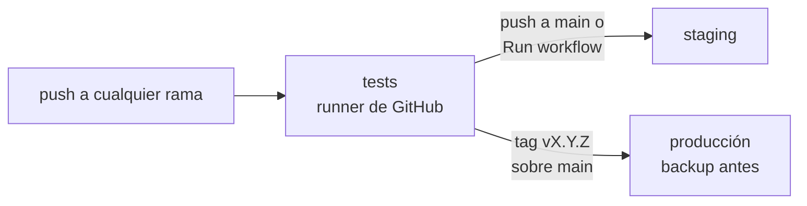

# Despliegue

El cotizador corre en el VPS de Crucianelli en dos entornos: **staging** (`staging.portalcrucianelli.site`), para
probar, y **producción** (`odoo.portalcrucianelli.site`). Son dos Odoo separados, con su propia base cada uno. La
configuración del servidor y el script de despliegue están en el repo privado de infra `ffunes-cru/servidor`.

Este flujo vale también para `cotizador_spreadsheet`, que tiene el mismo `.github/workflows/ci.yml`.

## Flujo



1. **Tests en cada push**, en cualquier rama: Odoo 19 y PostgreSQL 16 oficiales, con Chrome para los tests de
   navegador.
2. **Staging**: cada push a `main` se despliega solo si pasan los tests. Para probar otra rama antes de
   mergearla: *Actions → CI/CD → Run workflow* y elegir la rama.
3. **Producción**: un tag con la versión del manifiesto sobre un commit de `main`. Se acepta con o sin la serie
   de Odoo: manifiesto `19.0.2.1.0` → tag `v2.1.0` o `v19.0.2.1.0`.

   ```bash
   # 1. Subir la versión en __manifest__.py, commit y push a main (eso lo despliega en staging)
   # 2. Probar en staging; después, el tag sobre ese mismo commit
   git tag v2.1.0 && git push origin v2.1.0
   ```

   Si el tag no coincide con la versión del manifiesto, el job falla antes de conectarse al VPS. El script del
   VPS rechaza commits que no estén en `main`, hace un backup de la base y recién después actualiza.

## Cómo llega al VPS

Cada job entra por SSH con una clave cuyo único comando posible es `servidor/scripts/desplegar.sh <entorno>`
(comando forzado en `authorized_keys`), y le manda `cotizador <commit>`. El script trae ese commit, copia el
módulo, lo instala o actualiza y, si falla, restaura el código anterior y levanta Odoo igual. Un despliegue a
la vez en todo el servidor: si otro repo está desplegando, espera.

Las claves, el `known_hosts` y el destino son **secretos** de los environments `staging` y `produccion` de cada
repo (`STAGING_SSH_KEY`, `STAGING_KNOWN_HOSTS`, `STAGING_SSH_DESTINO` y los mismos con `PRODUCCION_`). Son
secretos y no variables para que GitHub los tape en los logs, que en un repo público ve cualquiera. El
environment `produccion` solo acepta tags `v*`.

Se cargan con `scripts/configurar_ci.sh` del repo de infra, desde una PC con `gh` logueado. Genera claves
nuevas para todos los repos que se le pasan e imprime las líneas para `authorized_keys`: pasarle siempre
todos los repos de módulos.

## Primera vez en un entorno

- **Orden**: primero `cotizador` y después `cotizador_spreadsheet`, que depende de él y de `spreadsheet_oca`.
- `spreadsheet_oca` va en `odoo-shared-addons` del VPS, copiado solo ese módulo de
  [OCA/spreadsheet](https://github.com/OCA/spreadsheet/tree/19.0) (ver el README del repo de infra).
- Después de instalar: moneda de la matriz, *Lista de Precios de Cotizaciones* e importar la matriz (ver
  [Operación](operacion.md#puesta-en-marcha)).

## Importar en un entorno con datos

Antes de importar de verdad, **Analizar** (no cambia nada) una máquina que no cambió: tiene que dar 0
configuraciones nuevas y 0 borradas. Si da borradas, la planilla no coincide con lo cargado (ver
[Importador](importador.md) §7). Probar siempre primero en staging con una copia de producción (README del repo
de infra, *Staging con datos reales*).
