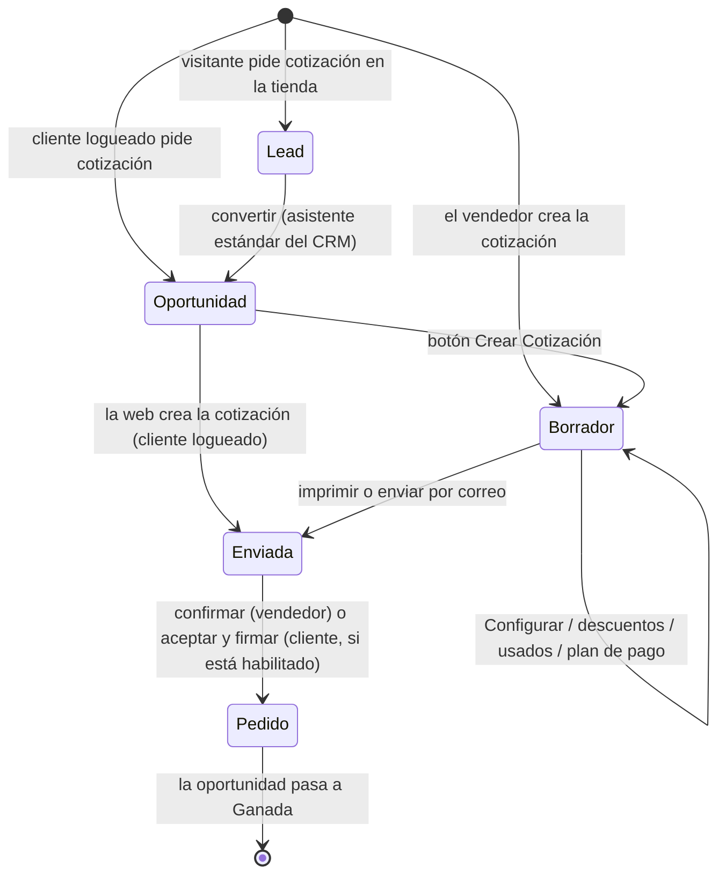
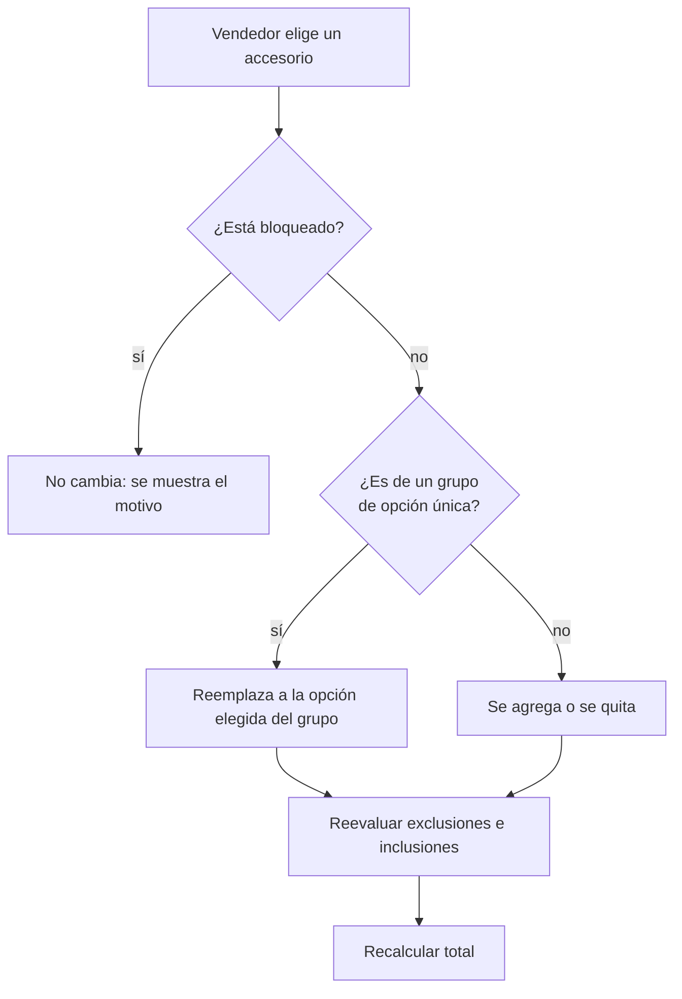
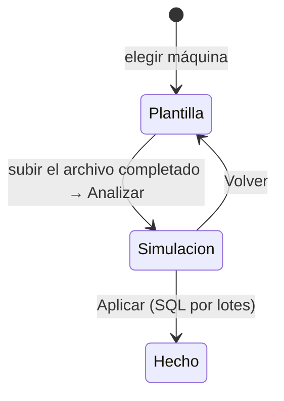

# Flujos

## De la solicitud a la venta

| Paso | Qué se exige | Qué pasa |
|---|---|---|
| Solicitud web (anónima) | Honeypot vacío, captcha, token del formulario, nombre y email o teléfono, configuración de esa máquina, límites por hora. | Solo un **lead** con la configuración, el equipamiento estándar, las notas y la IP. Sin contacto ni cotización. |
| Solicitud web (logueado) | Lo mismo, sin límites por hora. | Oportunidad a su nombre y cotización *Enviada* con la máquina y su equipamiento estándar, en la *Lista de Precios de Cotizaciones*. |
| Crear Cotización (CRM) | El lead tiene configuración y cliente (convertirlo antes). | Cotización con la máquina y su equipamiento estándar; queda vinculada a la oportunidad. |
| Configurar | Una selección que respete las reglas (ver abajo). | Secciones Máquina / Equipamiento / Accesorios con precios de matriz. Si la cotización no tenía productos, pasa a la *Lista de Precios de Cotizaciones*. |
| Guardar cambios de la cotización | — | Si tiene máquina y no tiene oportunidad, se crea una. La oportunidad toma cliente, vendedor e ingreso esperado (convertido a la moneda de la compañía). |
| Imprimir | — | Reporte con hoja de planes de pago (todos, los elegidos o ninguno). Un borrador pasa a *Enviada*. |
| Confirmar | Plan de pago, si *Plan de Pago Obligatorio* está activo. | Pedido de venta. La oportunidad pasa a la primera etapa ganada. |

## Reglas de accesorios

Las mismas reglas se aplican en tres lugares: el configurador (para guiar), el servidor al confirmar
(`_check_accessory_selection`) y la matriz al guardarla (`validate_rule_set`, para que el estándar sea
siempre una selección válida).

| Regla | En el configurador | Al confirmar | Al guardar la matriz |
|---|---|---|---|
| Exclusión (`:e`) | Con uno elegido, los demás del grupo se bloquean. | Error si hay dos elegidos. | Como máximo un ESTANDAR en el grupo. |
| Inclusión (`:i` + habilitante `:it`) | Sin habilitante elegido, los miembros se bloquean y se quitan. | Error si hay un miembro sin su habilitante. | Un miembro ESTANDAR exige su habilitante ESTANDAR. |
| Opción única (`:u`) | Botones de radio; siempre uno elegido; muestra la diferencia de precio con el estándar. Una opción bloqueada por una exclusión no se puede elegir (muestra el motivo). | Error si no hay exactamente uno del grupo. | Exactamente un ESTANDAR; el miembro puede estar además en exclusiones, no en una inclusión ni en otra opción única. |

**Opción única con exclusión.** Una alternativa de un grupo `:u` puede estar además en un grupo de
exclusión (`Kit Siembra:u|Cuchillas:e`). Si está elegida otra cuchilla, esa alternativa se bloquea; si la
elegida es la alternativa, se bloquean las cuchillas. La opción elegida nunca se bloquea, así que el grupo
siempre tiene una. Con una inclusión no se permite: la inclusión deselecciona sin habilitante y dejaría el
grupo vacío.

## Cantidad de un accesorio

1. Si la línea de accesorio tiene *Cantidad* > 0, esa.
2. Si la categoría del accesorio tiene *Atributo de Cantidad*: el número guardado en el valor de ese
   atributo de la configuración (`16 Líneas` → 16).
3. Si no, 1.

## Cascada de totales

Calculada en `sale.order._compute_totales_cotizador()`; la muestran el formulario, el portal y el PDF.
**Los descuentos y el plan de pago se aplican sobre el neto; el IVA se calcula después**, sobre el neto
con descuentos.

| Total | Cálculo |
|---|---|
| SUB TOTAL | Neto de las líneas de producto (máquina, accesorios y otros productos), sin IVA. |
| Total Descuentos | Descuentos comerciales sobre el neto (negativo). |
| Plan de Pago | Recargo (+) o descuento (−) del plan sobre el neto con descuentos. |
| SUB TOTAL NETO | SUB TOTAL + descuentos ± plan: la base del IVA. |
| IVA | Impuestos de productos, descuentos y plan (el total de impuestos de Odoo). |
| TOTAL | SUB TOTAL NETO + IVA. |
| Medios de pago (Usados) | Equipos usados tomados como pago (negativo, sin IVA). |
| **SALDO A CANCELAR** | TOTAL − usados (nunca menor a 0). Coincide con el total de la orden de Odoo. |

Ejemplo: 100.000 neto, descuento 6 % → 94.000 neto; IVA 10,5 % → 9.870; TOTAL 103.870.

- **Descuento comercial** (asistente *Añadir Descuento*): en porcentaje se calcula sobre el neto que dejan
  los descuentos anteriores (cascada); también puede ser un monto fijo neto. Se crea una línea por grupo
  de impuestos de la cotización, con esos impuestos, así cada alícuota baja su propia base de IVA.
- **Plan de pago**: una línea por grupo de impuestos con el producto del tipo de plan, sus impuestos y el
  porcentaje de la opción, sobre el neto con descuentos. Uno por cotización.
- **Siempre al día**: los descuentos en porcentaje y el plan guardan su porcentaje
  (`cotizador_pct`) y se **recalculan solos** cada vez que cambian las líneas o se usa *Actualizar
  precios* (`_cotizador_update_adjustments`). Los descuentos de monto fijo no cambian.
- **Usado**: monto acordado, línea sin producto ni impuestos.
- **Hoja de planes del PDF**: el total estimado de cada opción es el saldo que quedaría con ese plan
  (`_cotizador_simulate_plan`), con el mismo cálculo.

## Aceptación en el portal

Ajuste *Aceptación de Cotizaciones en el Portal*; cada cotización guarda su modo al crearse.

| Modo | Puede firmar y pagar el cliente |
|---|---|
| Estándar Odoo | Según la configuración de Ventas (firma / pago en línea). |
| Habilitado por el vendedor (por defecto) | Solo después de que el vendedor usa *Habilitar firma* (queda una nota en el chatter). |
| Solo el vendedor | Nunca: el cliente solo ve la propuesta. |

## Tienda: "Solo cotización" y "eCommerce"

| Modo | Ficha de máquina | Otros productos | Checkout y pago |
|---|---|---|---|
| Solo cotización (por defecto) | Configurador + *Solicitar Cotización* | *Solicitar Cotización* | Bloqueados: checkout y pago redirigen a /shop; express checkout y transacción de pago dan error. |
| eCommerce | Configurador + *Solicitar Cotización* | Carrito estándar | Estándar de Odoo. |

## Importación de la matriz

```mermaid
stateDiagram-v2
    [*] --> Borrador: abrir el importador
    Borrador --> Analizado: Analizar (no escribe)
    Analizado --> Borrador: Cargar otros archivos
    Analizado --> Importado: Importar (solo sin errores; revalida y escribe todo junto)
    Importado --> [*]
```

Cada máquina del archivo queda **igual al CSV**: lo que no está se borra (configuraciones, valores de
atributo, reglas sin uso) o se archiva (accesorios). El análisis muestra el detalle antes de escribir y,
al importar, ese detalle queda en el chatter de cada máquina. Ver [Importador §7.1](importador.md#71-re-importar-la-máquina-queda-igual-al-csv).

## Códigos de ingeniería (Teamcenter)

- La plantilla tiene una fila por variante (una por configuración). Ingeniería completa
  `CODIGO_INGENIERIA_TEAMCENTER`.
- Cada fila se cruza por `ID_Odoo` **confirmado con los valores de atributo de la fila**: plantillas
  generadas antes de crear las variantes traen ids de configuraciones, y un mismo número puede ser una
  variante y una configuración. Si el id no se confirma, se cruza por los valores de atributo.
- El código siempre va a la **referencia interna de la variante** (una configuración se resuelve a su
  variante).

## Consulta BCRA

- Al elegir un cliente con CUIT en la cotización se consulta la Central de Deudores; si tiene deudas o
  cheques rechazados aparece un aviso.
- *Situación BCRA* abre el informe completo. Si la API no responde se muestra el error (nunca "sin
  deudas").

## Ver también

- [Conceptos](conceptos.md) · [Seguridad](seguridad.md) · [Importador](importador.md)
