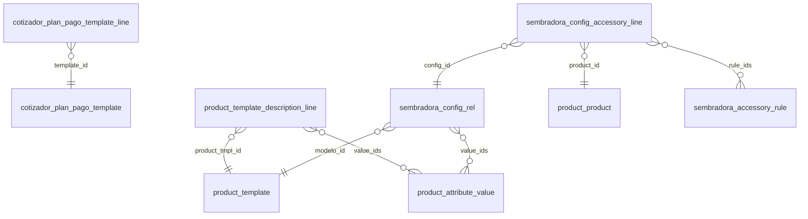

# Referencia generada del módulo Cotizador

> Archivo generado por `tools/documentacion.py`: no editar a mano. Cómo regenerarlo: ver el encabezado de ese archivo.

## Diagrama de datos

Relaciones de los modelos propios (sin los asistentes). `}o--||` = muchos a uno obligatorio, `}o--o|` = muchos a uno opcional, `}o--o{` = muchos a muchos.

## Modelos propios

### `cotizador.bcra.wizard` — Consulta Situación Crediticia BCRA (asistente)

| Campo | Tipo | Etiqueta | Detalle |
|---|---|---|---|
| `alerta_mensaje` | text | Mensaje de Situación |  |
| `cheque_ids` | one2many | Cheques Rechazados | → `cotizador.bcra.wizard.cheque` |
| `consulta_fecha` | datetime | Fecha Consulta |  |
| `cuit` | char | CUIT |  |
| `currency_id` | many2one | Moneda | → `res.currency` |
| `denominacion` | char | Denominación Oficial BCRA |  |
| `deuda_ids` | one2many | Deudas Bancarias | → `cotizador.bcra.wizard.deuda` |
| `monto_total` | monetary | Total Deuda Financiera |  |
| `partner_id` | many2one | Cliente | → `res.partner` |
| `peor_situacion` | selection | Peor Situación | valores: `1`, `2`, `3`, `4`, `5`, `6` |
| `tiene_deuda` | boolean | Tiene Deuda |  |

### `cotizador.bcra.wizard.cheque` — Línea de Cheque Rechazado BCRA (Wizard) (asistente)

| Campo | Tipo | Etiqueta | Detalle |
|---|---|---|---|
| `causal` | char | Causal |  |
| `currency_id` | many2one | Moneda | → `res.currency`; related `wizard_id.currency_id` |
| `estado` | char | Estado |  |
| `fecha_rechazo` | date | Fecha Rechazo |  |
| `monto` | monetary | Monto ($) |  |
| `nro_cheque` | char | Nº Cheque |  |
| `wizard_id` | many2one | Wizard | → `cotizador.bcra.wizard` |

### `cotizador.bcra.wizard.deuda` — Línea de Deuda BCRA (Wizard) (asistente)

| Campo | Tipo | Etiqueta | Detalle |
|---|---|---|---|
| `currency_id` | many2one | Moneda | → `res.currency`; related `wizard_id.currency_id` |
| `dias_atraso` | integer | Días Atraso |  |
| `entidad` | char | Entidad Financiera |  |
| `monto` | monetary | Monto ($) |  |
| `observaciones` | char | Observaciones |  |
| `periodo` | char | Período |  |
| `situacion` | selection | Situación | valores: `1`, `2`, `3`, `4`, `5`, `6` |
| `wizard_id` | many2one | Wizard | → `cotizador.bcra.wizard` |

### `cotizador.configurator.service` — Servicio RPC para el Configurador Visual de Sembradoras (servicio RPC)

Sin campos propios.

### `cotizador.descuento.wizard` — Añadir Descuento Comercial a la Cotización (asistente)

| Campo | Tipo | Etiqueta | Detalle |
|---|---|---|---|
| `base_neto` | monetary | Base de Cálculo (Neto) | calculado; Neto de los productos menos los descuentos ya cargados, sin IVA. |
| `currency_id` | many2one | Moneda | → `res.currency`; related `sale_order_id.currency_id` |
| `monto_descuento` | monetary | Descuento Neto Resultante | calculado (guardado) |
| `monto_fijo` | monetary | Monto Fijo ($) | Importe neto (sin IVA) a descontar. |
| `nombre` | char | Descripción del Descuento | obligatorio |
| `porcentaje` | float | Porcentaje (%) | Porcentaje sobre el neto vigente (después de los descuentos anteriores). |
| `sale_order_id` | many2one | Cotización / Pedido | → `sale.order`; obligatorio |
| `tipo_calculo` | selection | Tipo de Descuento | valores: `porcentaje`, `monto`; obligatorio |

### `cotizador.plan.pago.template` — Plantilla de Plan de Pago

| Campo | Tipo | Etiqueta | Detalle |
|---|---|---|---|
| `active` | boolean | Active |  |
| `line_ids` | one2many | Opciones del Plan | → `cotizador.plan.pago.template.line` |
| `name` | char | Nombre | obligatorio |
| `tipo` | selection | Tipo de Plan | valores: `canje_cereal`, `cheques`, `documentos`, `credito_bancario`; obligatorio |

### `cotizador.plan.pago.template.line` — Línea de Plantilla de Plan de Pago

| Campo | Tipo | Etiqueta | Detalle |
|---|---|---|---|
| `banco_linea` | char | Banco - Moneda - Línea |  |
| `cheques_desc` | char | Cheques |  |
| `condicion` | char | Condición |  |
| `descuento` | float | Descuento o Recargo (%) | Valor negativo = descuento, valor positivo = recargo. Ej: -10 para 10% descuento, 11 para 11% recargo |
| `entrega_canje` | char | Entrega (Canje) |  |
| `entrega_pct` | char | Entrega (%) |  |
| `financiacion` | char | Financiación |  |
| `name` | char | Descripción | calculado (guardado) |
| `opcion` | char | Opción |  |
| `plan_cheques` | char | Plan (Cheques) |  |
| `plan_documentos` | char | Plan (Documentos) |  |
| `plazo_tasa` | char | Plazo - Tasa |  |
| `promedio_dias` | integer | Promedio de Días |  |
| `saldo` | char | Saldo |  |
| `sequence` | integer | Secuencia |  |
| `template_id` | many2one | Plantilla | → `cotizador.plan.pago.template`; obligatorio |
| `tipo` | selection | Tipo de Plan | related `template_id.tipo` |

### `cotizador.plan.pago.wizard` — Wizard de Selección de Plan de Pago (asistente)

| Campo | Tipo | Etiqueta | Detalle |
|---|---|---|---|
| `sale_order_id` | many2one | Cotización | → `sale.order`; obligatorio |
| `wizard_line_ids` | one2many | Opciones de Planes Disponibles | → `cotizador.plan.pago.wizard.line` |

### `cotizador.plan.pago.wizard.line` — Línea Temporal de Selección de Plan (asistente)

| Campo | Tipo | Etiqueta | Detalle |
|---|---|---|---|
| `descuento` | float | Descuento / Recargo (%) |  |
| `name` | char | Detalle de la Opción |  |
| `template_line_id` | many2one | Template Line | → `cotizador.plan.pago.template.line`; obligatorio |
| `tipo` | selection | Tipo de Plan | valores: `canje_cereal`, `cheques`, `documentos`, `credito_bancario` |
| `total_simulado` | float | Total Simulado | calculado |
| `wizard_id` | many2one | Wizard | → `cotizador.plan.pago.wizard` |

### `cotizador.price.wizard.service` — Servicio RPC para Asistente de Modificación de Precios (servicio RPC)

Sin campos propios.

### `cotizador.studio.service` — Servicio Backend para Configurador Studio (servicio RPC)

Sin campos propios.

### `engineering.code.wizard` — Asistente de Carga de Códigos de Ingeniería (Teamcenter) (asistente)

| Campo | Tipo | Etiqueta | Detalle |
|---|---|---|---|
| `extra_in_file_count` | integer | Filas de Archivo sin Match en Odoo |  |
| `import_file` | binary | Archivo de Ingeniería (Excel o CSV) |  |
| `import_filename` | char | Nombre del Archivo |  |
| `matched_count` | integer | Coincidencias Exactas |  |
| `matched_data_json` | text | Datos de Coincidencia (JSON) |  |
| `missing_in_file_count` | integer | Variantes Odoo Faltantes en Archivo |  |
| `modelo_id` | many2one | Modelo de Máquina | → `product.template`; obligatorio; Seleccione el modelo de máquina a sincronizar con Teamcenter. |
| `preview_html` | html | Resumen de Simulación |  |
| `state` | selection | Estado | valores: `upload`, `preview`, `done` |
| `template_file` | binary | Descargar Plantilla Espejo |  |
| `template_filename` | char | Nombre Plantilla |  |
| `total_odoo_variants` | integer | Total Variantes en Odoo |  |

### `equipo.usado.wizard` — Añadir Equipo Usado como Pago (asistente)

| Campo | Tipo | Etiqueta | Detalle |
|---|---|---|---|
| `currency_id` | many2one | Moneda | → `res.currency`; related `sale_order_id.currency_id` |
| `descripcion` | text | Descripción del Equipo Usado | obligatorio; Indique marca, modelo, cantidad de líneas, año, estado o cualquier detalle del equipo tomado. |
| `monto` | monetary | Monto de Toma (Pago) | obligatorio; Valor acordado por el equipo usado que se descontará de la cotización. |
| `sale_order_id` | many2one | Cotización / Pedido | → `sale.order`; obligatorio |

### `product.template.description.line` — Regla de Descripción Paramétrica por Combinación de Atributos

| Campo | Tipo | Etiqueta | Detalle |
|---|---|---|---|
| `description` | html | Descripción Técnica (Rich Text) | obligatorio; Texto enriquecido que se mostrará en el configurador interactivo y en la cotización PDF. |
| `name` | char | Nombre / Referencia | Ej: Leaf Mecánica, Leaf Neumática, Pionera... |
| `product_tmpl_id` | many2one | Modelo de Máquina | → `product.template`; obligatorio |
| `sequence` | integer | Secuencia | Orden de evaluación y prioridad para desempatar reglas con igual cantidad de atributos. |
| `value_ids` | many2many | Valores de Atributo Requeridos | → `product.attribute.value`; Seleccione uno o más valores que deben estar presentes en la variante para aplicar esta descripción (ej. LEAF + Mecánico). |

### `sembradora.accessory.rule` — Regla de Exclusión/Inclusión de Accesorios

| Campo | Tipo | Etiqueta | Detalle |
|---|---|---|---|
| `description` | text | Descripción | Descripción opcional del comportamiento de esta regla. |
| `name` | char | Nombre | obligatorio |
| `rule_type` | selection | Tipo | valores: `exclusion`, `inclusion`, `choice`; obligatorio; Exclusión (:e): como máximo un accesorio del grupo. Inclusión (:i / :it): los accesorios del grupo se habilitan solo cuando su accesorio habilitante (trigger) está seleccionado. Opción única (:u): siempre hay exactamente uno seleccionado; arranca el ESTANDAR y elegir una alternativa lo reemplaza. |

### `sembradora.config.accessory.line` — Accesorio por Configuración con Precio

| Campo | Tipo | Etiqueta | Detalle |
|---|---|---|---|
| `config_id` | many2one | Configuración | → `sembradora.config.rel`; obligatorio |
| `currency_id` | many2one | Moneda | → `res.currency`; related `product_id.cotizador_currency_id`; Moneda de los precios de la matriz de este producto: los de sus configuraciones (máquina) o los de sus líneas de accesorio (accesorio). El importador la fija con la moneda elegida al importar. |
| `is_standard` | boolean | Estándar | Equipamiento estándar de la configuración: el accesorio aparece seleccionado por defecto en el configurador (el vendedor puede quitarlo). En el CSV se indica con Tipo_Item = ESTANDAR. |
| `is_trigger` | boolean | Es Trigger | Indica si este accesorio habilita a los demás accesorios pertenecientes a sus reglas de inclusión al ser seleccionado. |
| `price` | monetary | Precio en esta Configuración | En la Moneda del Cotizador del accesorio. |
| `product_id` | many2one | Accesorio | → `product.product`; obligatorio |
| `quantity` | float | Cantidad (opcional) | Si se especifica (> 0), se usa esta cantidad. Si se deja en 0, se calcula dinámicamente según la configuración. |
| `rule_ids` | many2many | Reglas | → `sembradora.accessory.rule` |

### `sembradora.config.rel` — Matriz de Configuraciones Permitidas

| Campo | Tipo | Etiqueta | Detalle |
|---|---|---|---|
| `accessory_line_ids` | one2many | Accesorios con Precio | → `sembradora.config.accessory.line` |
| `currency_id` | many2one | Moneda | → `res.currency`; related `modelo_id.cotizador_currency_id`; Moneda de los precios de la matriz de este producto: los de sus configuraciones (máquina) o los de sus líneas de accesorio (accesorio). El importador la fija con la moneda elegida al importar. |
| `description` | html | Descripción | calculado (guardado); Descripción detallada de la configuración, calculada con las reglas de Descripción Paramétrica del modelo. |
| `ext_id` | char | ID Externo |  |
| `modelo_id` | many2one | Modelo | → `product.template`; obligatorio |
| `name` | char | Configuración | calculado (guardado) |
| `price` | monetary | Precio de Configuración | En la Moneda del Cotizador del modelo. |
| `value_ids` | many2many | Combinación Permitida | → `product.attribute.value` |

### `sembradora.import.wizard` — Importador CSV de Configuraciones de Sembradora (asistente)

| Campo | Tipo | Etiqueta | Detalle |
|---|---|---|---|
| `analysis_summary` | html | Resumen del Análisis |  |
| `csv_file_ids` | many2many | Archivos CSV | → `ir.attachment` |
| `currency_id` | many2one | Moneda de los Precios | → `res.currency`; obligatorio; Moneda de Precio_Base y Precio_Item. Se guarda como Moneda del Cotizador de los modelos y accesorios importados. |
| `has_errors` | boolean | Tiene Errores |  |
| `parsed_data` | text | Datos Parseados |  |
| `state` | selection | Estado | valores: `draft`, `analyzed`, `done` |

## Campos agregados a modelos de Odoo

### `crm.lead` — Lead

| Campo | Tipo | Etiqueta | Detalle |
|---|---|---|---|
| `cotizador_config_id` | many2one | Configuración Solicitada | → `sembradora.config.rel`; Configuración elegida en la tienda online. "Crear Cotización" arma la cotización con esta máquina y su equipamiento estándar. |
| `cotizador_request_ip` | char | IP de la Solicitud Web | IP desde la que se envió la solicitud de cotización en la tienda (control de abuso). |
| `equipo_cotizado_id` | many2one | Equipo (Sembradora/Ferti) | → `product.template`; Modelo de máquina cotizada o de interés (categoría Máquina). |
| `lider_equipo_id` | many2one | Líder de Equipo | → `res.users`; calculado (guardado); Líder o responsable del equipo de ventas. |

### `product.attribute` — Product Attribute

| Campo | Tipo | Etiqueta | Detalle |
|---|---|---|---|
| `show_in_description` | boolean | Mostrar en Descripción | Si está activo, este atributo aparecerá en la descripción de la línea al confirmar la configuración en la cotización. Si está desactivado, la línea se ocultará en el wizard cuando sea opción única. |
| `show_incompatible_alternatives` | boolean | Mostrar Alternativas Incompatibles | Si está activo, se mostraran las alternativas incompatibles en el wizard de configuración. |

### `product.attribute.value` — Attribute Value

| Campo | Tipo | Etiqueta | Detalle |
|---|---|---|---|
| `cotizador_qty` | float | Cantidad (Cotizador) | Multiplicador de los accesorios que se cotizan por este atributo (categoría con Atributo de Cantidad). El importador lo toma del número del valor: "16 Líneas" → 16. |

### `product.category` — Product Category

| Campo | Tipo | Etiqueta | Detalle |
|---|---|---|---|
| `cotizador_qty_attribute_id` | many2one | Atributo de Cantidad (Cotizador) | → `product.attribute`; Los accesorios de esta categoría se cotizan multiplicando su precio por el número del valor de este atributo en la configuración (p.ej. "16 Líneas" → 16). El importador lo completa a partir de la columna Calc_param. |

### `product.product` — Product Variant

| Campo | Tipo | Etiqueta | Detalle |
|---|---|---|---|
| `available_attribute_value_ids` | many2many | Valores de Atributos Disponibles | → `product.attribute.value`; related `product_tmpl_id.available_attribute_value_ids`; Todos los valores de atributo disponibles para configurar en esta máquina. |
| `cotizador_currency_id` | many2one | Moneda del Cotizador | → `res.currency`; obligatorio; related `product_tmpl_id.cotizador_currency_id`; Moneda de los precios de la matriz de este producto: los de sus configuraciones (máquina) o los de sus líneas de accesorio (accesorio). El importador la fija con la moneda elegida al importar. |
| `cotizador_modelo_id` | many2one | Modelo de Máquina | → `product.template`; related `product_tmpl_id.cotizador_modelo_id`; Máquina a la que pertenece este accesorio. Cada accesorio es de un único modelo: solo puede usarse en configuraciones de esa máquina. |
| `description_default` | html | Descripción por Defecto | related `product_tmpl_id.description_default`; Descripción general de respaldo si la combinación configurada no coincide con ninguna regla específica. |
| `description_line_ids` | one2many | Reglas de Descripción Paramétrica | → `product.template.description.line`; related `product_tmpl_id.description_line_ids` |
| `is_accesorio` | boolean | Es Accesorio | related `product_tmpl_id.is_accesorio`; El producto está en la categoría Accesorio (o una subcategoría). |
| `is_maquina` | boolean | Es Máquina | related `product_tmpl_id.is_maquina`; El producto está en la categoría Máquina (o una subcategoría): es una máquina configurable. |

### `product.template` — Product

| Campo | Tipo | Etiqueta | Detalle |
|---|---|---|---|
| `available_attribute_value_ids` | many2many | Valores de Atributos Disponibles | → `product.attribute.value`; calculado; Todos los valores de atributo disponibles para configurar en esta máquina. |
| `cotizador_currency_id` | many2one | Moneda del Cotizador | → `res.currency`; obligatorio; Moneda de los precios de la matriz de este producto: los de sus configuraciones (máquina) o los de sus líneas de accesorio (accesorio). El importador la fija con la moneda elegida al importar. |
| `cotizador_modelo_id` | many2one | Modelo de Máquina | → `product.template`; Máquina a la que pertenece este accesorio. Cada accesorio es de un único modelo: solo puede usarse en configuraciones de esa máquina. |
| `description_default` | html | Descripción por Defecto | Descripción general de respaldo si la combinación configurada no coincide con ninguna regla específica. |
| `description_line_ids` | one2many | Reglas de Descripción Paramétrica | → `product.template.description.line` |
| `is_accesorio` | boolean | Es Accesorio | calculado (guardado); El producto está en la categoría Accesorio (o una subcategoría). |
| `is_maquina` | boolean | Es Máquina | calculado (guardado); El producto está en la categoría Máquina (o una subcategoría): es una máquina configurable. |

### `res.company` — Companies

| Campo | Tipo | Etiqueta | Detalle |
|---|---|---|---|
| `cotizador_pricelist_id` | many2one | Lista de Precios de Cotizaciones | → `product.pricelist`; Lista de precios de las cotizaciones de máquinas (backend y solicitudes web). Si se deja vacía se usa la lista habitual del cliente. |
| `cotizador_tax_id` | many2one | Impuesto de Maquinaria | → `account.tax`; Impuesto que se aplica a máquinas y accesorios cotizados con el configurador. Si se deja vacío se usan los impuestos de cada producto. |

### `res.config.settings` — Config Settings (asistente)

| Campo | Tipo | Etiqueta | Detalle |
|---|---|---|---|
| `cotizador_captcha_configured` | boolean | Cotizador Captcha Configured | calculado |
| `cotizador_condiciones_generales_default` | text | Condiciones Generales Predeterminadas | Texto constante estándar de condiciones comerciales que se incluirá automáticamente en todas las nuevas cotizaciones. |
| `cotizador_ecommerce_mode` | selection | Modo de la Tienda Online | valores: `quote_only`, `ecommerce`; parámetro `cotizador.ecommerce_mode`; Define si la tienda online permite solicitar cotizaciones directamente al CRM o si opera como un eCommerce con checkout y cobro. |
| `cotizador_modo_silencioso` | boolean | Modo Silencioso (Configurador) | parámetro `cotizador.modo_silencioso`; Oculta el precio unitario de los accesorios en el configurador interactivo, mostrando únicamente el precio total. |
| `cotizador_plan_pago_required` | boolean | Plan de Pago Obligatorio | parámetro `cotizador.plan_pago_required`; Si se activa, no se podrá confirmar una cotización sin tener un Plan de Pago seleccionado. |
| `cotizador_portal_confirmation_mode` | selection | Aceptación de Cotizaciones en el Portal | valores: `standard`, `salesman_enables`, `salesman_only`; parámetro `cotizador.portal_confirmation_mode`; Controla si el cliente puede aceptar y firmar sus cotizaciones desde la web, o si requiere validación del asesor comercial. |
| `cotizador_pricelist_id` | many2one | Lista de Precios de Cotizaciones | → `product.pricelist`; related `company_id.cotizador_pricelist_id`; Lista de precios de las cotizaciones de máquinas (backend y solicitudes web). Si se deja vacía se usa la lista habitual del cliente. |
| `cotizador_quote_min_seconds` | integer | Tiempo mínimo para completar el formulario (segundos) | parámetro `cotizador.quote_min_seconds`; Una solicitud web enviada antes de este tiempo desde que se abrió la página se considera un bot. |
| `cotizador_quote_rate_limit_contact` | integer | Solicitudes web por email/teléfono (por hora) | parámetro `cotizador.quote_rate_limit_contact`; Máximo de solicitudes de cotización anónimas con el mismo email o teléfono por hora. 0 = sin límite. |
| `cotizador_quote_rate_limit_ip` | integer | Solicitudes web por IP (por hora) | parámetro `cotizador.quote_rate_limit_ip`; Máximo de solicitudes de cotización anónimas desde una misma IP por hora. 0 = sin límite. |
| `cotizador_tax_id` | many2one | Impuesto de Maquinaria | → `account.tax`; related `company_id.cotizador_tax_id`; Impuesto que se aplica a máquinas y accesorios cotizados con el configurador. Si se deja vacío se usan los impuestos de cada producto. |

### `res.users` — User

| Campo | Tipo | Etiqueta | Detalle |
|---|---|---|---|
| `plan_pago_template_line_ids` | many2many | Planes de Pago Favoritos / Visibles | → `cotizador.plan.pago.template.line`; Seleccione qué planes de pago estarán visibles por defecto en las cotizaciones que genere este usuario. |

### `sale.order` — Sales Order

| Campo | Tipo | Etiqueta | Detalle |
|---|---|---|---|
| `amount_descuentos` | monetary | Total Descuentos | calculado (guardado); Descuentos comerciales sobre el neto (importe negativo). |
| `amount_iva_productos` | monetary | IVA | calculado (guardado); Impuestos de productos, descuentos y plan de pago. |
| `amount_plan_pago` | monetary | Plan de Pago | calculado (guardado); Recargo (positivo) o descuento (negativo) del plan de pago, sobre el neto con descuentos. |
| `amount_saldo_cancelar` | monetary | SALDO A CANCELAR | calculado (guardado); TOTAL − usados (nunca menor a 0). |
| `amount_subtotal_neto` | monetary | SUB TOTAL NETO | calculado (guardado); SUB TOTAL con descuentos y plan de pago: la base del IVA. |
| `amount_subtotal_productos` | monetary | SUB TOTAL | calculado (guardado); Neto de las líneas de producto (máquina, accesorios y otros productos), sin impuestos. |
| `amount_total_base` | monetary | TOTAL | calculado (guardado); SUB TOTAL NETO + IVA. |
| `amount_usados` | monetary | Medios de pago (Usados) | calculado (guardado); Equipos usados tomados como parte de pago (importe negativo, sin IVA). |
| `condiciones_generales` | text | Condiciones Generales | Condiciones comerciales constantes preconfiguradas que se imprimen al pie de la cotización. |
| `descuento_line_ids` | one2many | Descuentos Aplicados | → `sale.order.line`; calculado |
| `equipo_cotizado_id` | many2one | Equipo Cotizado | → `product.template`; calculado (guardado); Modelo de máquina cotizada (categoría Máquina). |
| `plan_pago_line_ids` | many2many | Planes de Pago a Imprimir | → `cotizador.plan.pago.template.line`; Seleccione qué planes de pago se imprimirán en la hoja de planes de pago de esta cotización. |
| `portal_confirmation_allowed` | boolean | Firma del Cliente Habilitada | Si el modo es "Habilitado por el Vendedor", active esta casilla para que el cliente pueda ver el botón "Aceptar y Firmar" en el portal web. |
| `portal_confirmation_mode` | selection | Modo de Aceptación Portal | valores: `standard`, `salesman_enables`, `salesman_only`; obligatorio; Determina si el cliente puede firmar/aceptar esta cotización desde el portal web o si requiere habilitación del comercial. |
| `usado_line_ids` | one2many | Equipos Usados Tomados | → `sale.order.line`; calculado |

### `sale.order.line` — Sales Order Line

| Campo | Tipo | Etiqueta | Detalle |
|---|---|---|---|
| `cotizador_matrix_price` | float | Precio de Matriz | Precio de matriz (en la Moneda del Cotizador del producto) con que se cotizó la máquina o el accesorio. Si Odoo recalcula el precio de la línea (cambio de cantidad, Actualizar precios), parte de este valor y le aplica la lista de precios y la moneda de la cotización. |
| `cotizador_matrix_priced` | boolean | Con Precio de Matriz | La línea la creó el cotizador con un precio de matriz (también cuando es 0, sin cargo). |
| `cotizador_pct` | float | Porcentaje (Cotizador) | Descuento comercial: porcentaje sobre el neto (0 = monto fijo). Plan de pago: recargo (+) o descuento (−) sobre el neto con descuentos. El importe se recalcula al cambiar las líneas. |
| `cotizador_section` | selection | Sección del Cotizador | valores: `maquina`, `equipamiento`, `accesorios`, `descuentos`, `usados`; Identifica las secciones que genera el cotizador (independiente del texto de la sección). |
| `is_descuento` | boolean | Es Descuento Comercial |  |
| `is_equipo_usado` | boolean | Es Equipo Usado |  |
| `is_plan_pago` | boolean | Es Plan de Pago |  |

## Puntos de entrada

Métodos públicos (invocables por RPC) y quién los llama: botones de vistas, JavaScript (`orm.call`), Python y plantillas QWeb. Las llamadas desde código se buscan por nombre, así que un nombre repetido en otro modelo puede aparecer de más.

| Modelo | Método | Qué hace | Llamado desde |
|---|---|---|---|
| `cotizador.configurator.service` | `confirm_configuration` | Agrega a la cotización la máquina configurada y los accesorios elegidos. | JS `static/src/components/configurador/configurador.js` |
| `cotizador.configurator.service` | `get_config_accessories` | Accesorios de una configuración, con cantidad y precio como quedarán en la orden. | JS `static/src/components/configurador/configurador.js` |
| `cotizador.configurator.service` | `get_initial_data` | Datos iniciales: la cotización y el catálogo de máquinas. | JS `static/src/components/configurador/configurador.js` |
| `cotizador.configurator.service` | `get_model_matrix` | Matriz completa de una máquina, para filtrarla en el navegador sin más llamadas. | JS `static/src/components/configurador/configurador.js` |
| `cotizador.descuento.wizard` | `action_confirm` | Crea las líneas de descuento (y la sección si falta) y actualiza la oportunidad. | `models/sale_order_inherit.py`; botón en `cotizador.descuento.wizard.form` |
| `cotizador.plan.pago.template.line` | `action_select_line` | Agrega esta opción a la cotización del contexto (`default_sale_order_id` o `active_id`). | `models/plan_pago.py` |
| `cotizador.plan.pago.wizard.line` | `action_select_line` | Elige esta opción: delega en cotizador.plan.pago.template.line.action_select_line(). | `models/plan_pago.py`; botón en `cotizador.plan.pago.wizard.form` |
| `cotizador.price.wizard.service` | `get_accessory_data` | Accesorios de las configuraciones de un modelo, separados en globales y específicos. | JS `static/src/components/price_wizard/price_wizard.js` |
| `cotizador.price.wizard.service` | `get_base_configs_data` | Configuraciones de un modelo con sus precios, y los atributos para filtrar. | JS `static/src/components/price_wizard/price_wizard.js` |
| `cotizador.price.wizard.service` | `get_models` | Máquinas para elegir en el asistente. | JS `static/src/components/price_wizard/price_wizard.js` |
| `cotizador.price.wizard.service` | `save_base_prices` | Guarda precios de configuraciones. | JS `static/src/components/price_wizard/price_wizard.js` |
| `cotizador.price.wizard.service` | `save_global_accessory_prices` | Fija el precio de accesorios globales en todas las configuraciones del modelo. | JS `static/src/components/price_wizard/price_wizard.js` |
| `cotizador.price.wizard.service` | `save_specific_accessory_prices` | Guarda precios de líneas de accesorio puntuales. | JS `static/src/components/price_wizard/price_wizard.js` |
| `cotizador.studio.service` | `batch_create_branch_configurations` | Habilita en bloque todas las combinaciones que faltan bajo una rama del árbol. | JS `static/src/components/configurador_studio/configurador_studio.js` |
| `cotizador.studio.service` | `create_configuration` | Habilita una combinación: crea su configuración. | JS `static/src/components/configurador_studio/configurador_studio.js` |
| `cotizador.studio.service` | `delete_configuration` | Deshabilita una combinación: borra su configuración (y sus líneas de accesorio). | JS `static/src/components/configurador_studio/configurador_studio.js` |
| `cotizador.studio.service` | `get_model_studio_data` | Matriz de una máquina para el árbol del Studio. | JS `static/src/components/configurador_studio/configurador_studio.js` |
| `cotizador.studio.service` | `get_studio_overview` | Máquinas con sus métricas para el selector del Studio. | JS `static/src/components/configurador_studio/configurador_studio.js` |
| `cotizador.studio.service` | `quick_update_config_engineering_code` | Cambia el código de ingeniería (`ext_id`) de una configuración y lo copia a la variante. | JS `static/src/components/configurador_studio/configurador_studio.js` |
| `cotizador.studio.service` | `quick_update_config_price` | Cambia el precio de una configuración (edición en la hoja del árbol). | JS `static/src/components/configurador_studio/configurador_studio.js` |
| `engineering.code.wizard` | `action_analyze_file` | Paso 2: cruza las filas del archivo con las variantes y configuraciones del modelo. | botón en `engineering.code.wizard.form` |
| `engineering.code.wizard` | `action_apply_codes` | Paso 3: escribe los códigos simulados. | botón en `engineering.code.wizard.form` |
| `engineering.code.wizard` | `action_back_to_upload` | Vuelve al paso 1 descartando el archivo y la simulación. | botón en `engineering.code.wizard.form` |
| `engineering.code.wizard` | `action_generate_template` | Paso 1: genera la plantilla espejo para que Ingeniería complete los códigos. | botón en `engineering.code.wizard.form` |
| `equipo.usado.wizard` | `action_confirm` | Crea la línea del usado (y la sección si falta) y actualiza la oportunidad. | `models/sale_order_inherit.py`; botón en `equipo.usado.wizard.form` |
| `sembradora.import.wizard` | `action_analyze` | Paso 1: valida los archivos y resume lo que se creará o actualizará. No escribe datos. | botón en `sembradora.import.wizard.form` |
| `sembradora.import.wizard` | `action_back_to_upload` | Vuelve a la carga de archivos descartando el análisis. | botón en `sembradora.import.wizard.form` |
| `sembradora.import.wizard` | `action_import` | Paso 2: crea o actualiza todo lo analizado, en una sola transacción. | botón en `sembradora.import.wizard.form` |
| `crm.lead` | `action_cotizador_create_quotation` | Botón *Crear Cotización*: cotización de la configuración pedida en la web. | botón en `crm.lead.form.inherit.cotizador` |
| `product.template` | `action_open_engineering_wizard` | Botón *Códigos Teamcenter* de la ficha de la máquina. | botón en `product.template.form.inherit.cotizador.description` |
| `product.template` | `action_open_in_studio` | Botón *Configurador Studio* de la ficha de la máquina. | botón en `product.template.form.inherit.cotizador.description` |
| `product.template` | `get_config_description` | Descripción HTML de una combinación según las reglas de *Descripción Paramétrica*. | QWeb `report/report_cotizacion_planes.xml`; `models/product_template_inherit.py`; `models/sembradora_config.py` |
| `product.template` | `get_sequential_configurator_json` | Datos del configurador paso a paso de la ficha de producto en la tienda. | QWeb `views/website_sale_templates.xml` |
| `res.config.settings` | `get_values` | Lee además las condiciones generales (texto por defecto si no se configuraron). | `models/res_config_settings.py` |
| `res.config.settings` | `set_values` | Guarda además las condiciones generales: un campo Text no admite `config_parameter`. | `models/res_config_settings.py` |
| `sale.order` | `action_confirm` | Confirma exigiendo plan de pago si está configurado, y marca ganada la oportunidad. | `models/sale_order_inherit.py` |
| `sale.order` | `action_disable_portal_confirmation` | Botón del vendedor: deshabilita la aceptación y firma del cliente en el portal (con nota en el chatter). | botón en `sale.order.form.inherit.cotizador` |
| `sale.order` | `action_enable_portal_confirmation` | Botón del vendedor: habilita la aceptación y firma del cliente en el portal (con nota en el chatter). | botón en `sale.order.form.inherit.cotizador` |
| `sale.order` | `action_open_config_wizard` | Botón *Configurar*: abre el configurador visual sobre esta cotización. | `models/sale_order_inherit.py`; botón en `sale.order.form.inherit.cotizador` |
| `sale.order` | `action_open_descuento_wizard` | Abre el asistente de descuento comercial. | `models/sale_order_inherit.py`; botón en `sale.order.form.inherit.cotizador` |
| `sale.order` | `action_open_discount_wizard` | El botón nativo de descuento de Odoo abre el descuento del cotizador. | — |
| `sale.order` | `action_open_equipo_usado_wizard` | Abre el asistente para tomar un equipo usado como parte de pago. | `models/sale_order_inherit.py`; botón en `sale.order.form.inherit.cotizador` |
| `sale.order` | `action_open_plan_pago_wizard` | Botón de plan de pago: abre la selección con todas las opciones activas. | `models/plan_pago.py`; botón en `sale.order.form.inherit.cotizador` |
| `sale.order` | `action_ver_bcra_wizard` | Botón *Situación BCRA*: consulta el BCRA y abre el informe. | `models/bcra_wizard.py`; botón en `sale.order.form.inherit.cotizador` |
| `sale.order` | `print_quotation` | Botón estándar *Imprimir*: los planes elegidos o, si no hay, todos. | — |
| `sale.order.line` | `action_open_config_wizard` | Botón de la lista de líneas: delega en la orden. | `models/sale_order_inherit.py` |
| `sale.order.line` | `action_open_descuento_wizard` | Botón de la lista de líneas: delega en la orden. | `models/sale_order_inherit.py` |
| `sale.order.line` | `action_open_discount_wizard` | Botón nativo de descuento en la lista de líneas: descuento del cotizador. | — |
| `sale.order.line` | `action_open_equipo_usado_wizard` | Botón de la lista de líneas: delega en la orden. | `models/sale_order_inherit.py` |

## Permisos por modelo

L = leer, E = escribir, C = crear, B = borrar. Sin fila: el grupo no accede al modelo. Ver [permisos de acceso](odoo.md#permisos-de-acceso).

| Modelo | Grupo | Permisos |
|---|---|---|
| `cotizador.bcra.wizard` | Role / User | `LECB` |
| `cotizador.bcra.wizard.cheque` | Role / User | `LECB` |
| `cotizador.bcra.wizard.deuda` | Role / User | `LECB` |
| `cotizador.descuento.wizard` | Role / User | `LECB` |
| `cotizador.plan.pago.template` | Administrador del Configurador | `LECB` |
| `cotizador.plan.pago.template` | Role / User | `L---` |
| `cotizador.plan.pago.template.line` | Administrador del Configurador | `LECB` |
| `cotizador.plan.pago.template.line` | Role / User | `L---` |
| `cotizador.plan.pago.wizard` | Role / User | `LECB` |
| `cotizador.plan.pago.wizard.line` | Role / User | `LECB` |
| `engineering.code.wizard` | Administrador del Configurador | `LECB` |
| `equipo.usado.wizard` | Role / User | `LECB` |
| `product.template.description.line` | Administrador del Configurador | `LECB` |
| `product.template.description.line` | Role / User | `L---` |
| `sembradora.accessory.rule` | Administrador del Configurador | `LECB` |
| `sembradora.accessory.rule` | Role / User | `L---` |
| `sembradora.config.accessory.line` | Administrador del Configurador | `LECB` |
| `sembradora.config.accessory.line` | Role / User | `L---` |
| `sembradora.config.rel` | Administrador del Configurador | `LECB` |
| `sembradora.config.rel` | Role / User | `L---` |
| `sembradora.import.wizard` | Administrador del Configurador | `LECB` |

## Parámetros del sistema

Ajustes guardados en `ir.config_parameter` (ver [Operación](operacion.md#ajustes)).

| Parámetro | Ajuste | Por defecto |
|---|---|---|
| `cotizador.condiciones_generales_default` | Condiciones Generales Predeterminadas | ver `DEFAULT_CONDICIONES_GENERALES` |
| `cotizador.ecommerce_mode` | Modo de la Tienda Online | quote_only |
| `cotizador.modo_silencioso` | Modo Silencioso (Configurador) |  |
| `cotizador.plan_pago_required` | Plan de Pago Obligatorio |  |
| `cotizador.portal_confirmation_mode` | Aceptación de Cotizaciones en el Portal | salesman_enables |
| `cotizador.quote_min_seconds` | Tiempo mínimo para completar el formulario (segundos) | 3 |
| `cotizador.quote_rate_limit_contact` | Solicitudes web por email/teléfono (por hora) | 3 |
| `cotizador.quote_rate_limit_ip` | Solicitudes web por IP (por hora) | 5 |
