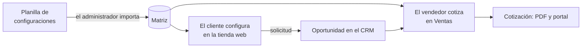

# Guía de uso

Cómo se usa el cotizador día a día, sin entrar en el código. Para la parte técnica, ver
[Desarrollo y mantenimiento](../arquitectura.md).

## Qué hace

El cotizador arma cotizaciones de sembradoras configurables. Una máquina se elige por sus características
(cantidad de líneas, distancia, tecnología…) y no todas las combinaciones existen. Las que existen, con su
precio y sus accesorios, están en la **matriz**, que mantiene el administrador a partir de la planilla de
configuraciones.

## Quién hace qué

| Rol | Dónde trabaja | Qué hace | Guía |
|---|---|---|---|
| **Vendedor** (y su líder, supervisor y gerencia: [niveles](#niveles-de-usuario)) | *Ventas* y *CRM* | Cotiza con el configurador, agrega descuentos, usados y plan de pago, consulta el BCRA, imprime y envía. | [Cotizar una máquina](cotizar.md) |
| **Administrador del Configurador** | *Ventas › Configuración › Configurador Sembradoras* | Todo lo del vendedor, y además mantiene la matriz, las reglas de accesorios, los planes de pago y los ajustes. | [Mantener la matriz](matriz.md) · [Puesta en marcha y ajustes](administracion.md) |
| **Cliente** | Tienda web y portal (`/my`) | Configura una máquina y pide cotización; ve sus cotizaciones y, si el vendedor lo habilita, las firma. | [Tienda y portal](tienda.md) |

El vendedor **no puede modificar la matriz**: solo la lee. Si un precio o una combinación está mal, lo
corrige el administrador. Los permisos se asignan en *Ajustes › Usuarios*, sección *Configurador de
Sembradoras*.

## Niveles de usuario

Cada **concesionario** es un *equipo de ventas* de Odoo: su **líder** es el usuario del concesionario y sus
**miembros**, los vendedores. Varios concesionarios forman una **zona**, a cargo de un **supervisor**. Qué ve y qué
edita cada uno en cotizaciones y oportunidades del CRM:

| Nivel | Ve | Edita |
|---|---|---|
| **Gerencia** | Todo | Todo |
| **Supervisor de zona** | Lo de los concesionarios de su zona, y puede filtrar o agrupar por concesionario | Solo lo que crea él. Cuando asigna una cotización a un concesionario, la sigue viendo pero ya no la edita. |
| **Líder de concesionario** | Todo lo de su concesionario | Todo lo de su concesionario, incluido lo de sus vendedores |
| **Vendedor** | Solo lo suyo | Solo lo suyo |

Para asignar una cotización, el supervisor completa **Concesionario** y **Vendedor** (el líder o un vendedor del
concesionario). Los contactos (clientes) no se restringen: los ve cualquier usuario de Ventas.

Cómo se configura: [Puesta en marcha y ajustes › Niveles de usuario](administracion.md#niveles-de-usuario).

## Palabras que conviene conocer

| Término | Qué es |
|---|---|
| **Máquina** | El modelo que se vende, por ejemplo *Pionera*. |
| **Configuración** | Una combinación válida de una máquina (por ejemplo, 16 líneas a 52 cm), con su precio. |
| **Accesorio** | Algo opcional que se agrega a la máquina. Cada máquina tiene sus propios accesorios. |
| **Equipamiento estándar** | Accesorios que vienen incluidos: arrancan elegidos. |
| **Opción única** | Grupo del que siempre va exactamente uno, por ejemplo el kit de siembra: elegir otro reemplaza al estándar. |
| **Excluyentes** | Accesorios de los que se puede elegir como máximo uno, por ejemplo dos cuchillas distintas. |
| **Requiere otro** | Accesorio que solo se puede elegir si está elegido otro, por ejemplo el sensor necesita el monitor. |
| **Por cantidad** | Accesorio que se cotiza por unidad de una característica: un sensor por línea en una máquina de 16 líneas son 16 sensores. |
| **Plan de pago** | Forma de pago (canje, cheques, documentos, crédito bancario) con su recargo o descuento. |
| **Toma de usado** | Equipo usado que el cliente entrega como parte de pago. |

El glosario completo, con un ejemplo de punta a punta, está en [Conceptos](../conceptos.md).
